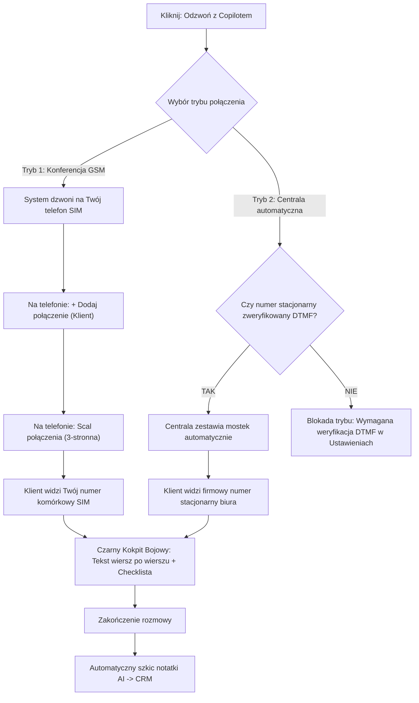

# Podręcznik Użytkownika Platformy EVA (Telefonia, Marketing AI & Live Copilot)

Wirtualna Asystentka EVA działa w bezpiecznej chmurze telekomunikacyjnej. System integruje się bezpośrednio z operatorami cyfrowymi, dzięki czemu nie musisz kupować żadnych central telefonicznych, bramek VoIP ani dedykowanego sprzętu. Twoja firma zyskuje profesjonalną, inteligentną obsługę połączeń przychodzących oraz nowoczesnego cichego suflera do rozmów handlowych.

---

## 1. Pakiety i Przeznaczenie Systemu

Platforma oferuje dedykowane plany dostosowane do specyfiki jednoosobowych działalności, ekspertów oraz wieloosobowych zespołów:

### Dla Profesjonalistów Solo i Wolnych Zawodów
* **Pakiet Osobisty (149 zł netto / mc)**:
  * **100 darmowych minut** w abonamencie (0,60 zł/min po przekroczeniu).
  * Osobisty sekretarz AI odbierający połączenia, gdy nie możesz rozmawiać.
  * Ochrona prywatności (*Privacy Shield* – powitanie z imienia bez ujawniania nazwiska).
  * Kontakty VIP z dostępem priorytetowym oraz Czas Skupienia (*Deep Work*).
  * Tarcza Wiedzy Poufnej zabezpieczona kodem PIN.
* **Pakiet Osobisty Ekspert (349 zł netto / mc)**:
  * **300 darmowych minut** w abonamencie (preferencyjna stawka 0,50 zł/min).
  * Wszystkie funkcje Pakietu Osobistego.
  * **⚡ Moduł Live Call Copilot**: Cichy sufler rozmów na żywo z podpowiedziami faktów linijka po linijce, checklistą celów i notatkami AI.
  * Inteligentna kwalifikacja spraw i budżetu klienta.
  * Pilnowanie zasięgu dojazdów z 1-kliknięciowym SMS-em odwołania.
  * 1-klik transfer wniosków z rozmów do Bazy Wiedzy (FAQ).
  * Automatyczny moduł potwierdzeń spotkań 24h przed terminem.

### Dla Salonów, Klinik i Zespołów Firmowych (B2B)
* **Pakiet B2B Standard (199 zł netto / mc)**:
  * **100 darmowych minut** w abonamencie na rozmowy asystenta.
  * Całodobowa recepcja AI (24/7) umawiająca wizyty i odpowiadająca na pytania o ofertę.
  * Wieloosobowy grafik zespołu, przypisywanie usług do pracowników i dni wolne.
  * Potwierdzenia i przypomnienia SMS z linkami dojazdu i obsługą anulacji.
  * Dedykowany numer wirtualny SIP do przekierowań.
* **Pakiet B2B Premium (399 zł netto / mc)**:
  * **300 darmowych minut** w abonamencie.
  * Wszystkie możliwości Pakietu B2B Standard.
  * **⚡ Pełny moduł Live Call Copilot**: Wsparcie handlowców na żywo podczas rozmów sprzedażowych.
  * **☎️ Prezentacja Numeru Stacjonarnego Firmy (Caller ID)**: Autoryzowana prezentacja lokalnego numeru biura (weryfikacja DTMF).
  * Dynamiczna checklista celów rozmowy i automatyczne szkice notatek AI do CRM.
  * Zaawansowany audyt menedżerski rozmów i automatyczne doszkalanie Bazy Wiedzy.

---

## 2. Konfiguracja Przekierowań Połączeń (Kody MMI)

Nie musisz zmieniać swojego dotychczasowego numeru telefonu. Asystentka przejmuje połączenia tylko w sytuacjach, które sam określisz.

W zakładce **Ustawienia Asystenta** znajdziesz swój dedykowany numer wirtualny (np. `+48 123 456 789`). Wprowadź na klawiaturze swojego smartfona odpowiedni kod MMI i zatwierdź zieloną słuchawką:

| Sytuacja | Kod do wpisania na smartfonie | Opis działania |
| :--- | :--- | :--- |
| **Gdy nie odbierasz (15 sek.)** | `*61*+48NUMER*11*15#` | Telefon dzwoni u Ciebie przez 15 sekund (~3 sygnały). Jeśli nie podniesiesz słuchawki, EVA przejmuje rozmowę. |
| **Gdy linia jest zajęta** | `*67*+48NUMER#` | Gdy prowadzisz inną rozmowę lub manualnie odrzucisz połączenie czerwonym przyciskiem, klient natychmiast trafia do asystentki. |
| **Gdy poza zasięgiem / wyłączony** | `*62*+48NUMER#` | Gdy rozładuje Ci się bateria lub jedziesz tunelem, żaden klient nie usłyszy głuchego sygnału. |
| **Przekierowanie bezwarunkowe (zawsze)** | `*21*+48NUMER#` | Wszystkie połączenia natychmiast trafiają do asystentki (idealne na urlop, weekend lub tryb skupienia). |
| **Wyłączenie wszystkich przekierowań** | `##002#` | Resetuje wszystkie przekierowania w sieci Twojego operatora komórkowego. |

> [!NOTE]
> Zastąp ciąg `+48NUMER` numerem wirtualnym wyświetlanym w Twoim panelu EVA. Wpisanie kodu jest jednorazowe i bezpłatne u każdego polskiego operatora komórkowego (Orange, Play, Plus, T-Mobile).

---

## 3. Inteligentne Funkcje Połączeń Przychodzących (Inbound)

1. **Błyskawiczne Powitanie (Zero-Latency Greeting)**:
   Asystentka natychmiast po odebraniu wita rozmówcę ciepłym, naturalnym głosem, bez sztucznych pauz i mechanicznych zapowiedzi.
2. **Pamięć Klienta i Rozpoznawanie (Caller ID)**:
   Gdy dzwoni osoba zapisana w Twojej kartotece, asystentka natychmiast zwraca się do niej po imieniu (np. *„Dzień dobry Pani Anno, miło Panią ponownie słyszeć. Czy chodzi o kolejny zabieg?”*).
3. **Wielokanałowość (Głos + SMS w czasie rzeczywistym)**:
   Podczas rozmowy EVA potrafi wysyłać SMS-y informacyjne: z pineską dojazdu Google Maps, linkiem do płatności lub regulaminem.
4. **Tarcza Przeciw Pustym Terminom (No-Shows)**:
   Wraz z SMS-em potwierdzającym wizytę klient otrzymuje informację: *„Jeśli plany ulegną zmianie, odpisz ANULUJ”*. Gdy klient to zrobi, system sam zwolni termin w kalendarzu.
5. **Czas Skupienia (Deep Work) & Dyskrecja**:
   Możesz zdefiniować godziny, w których asystentka chroni Cię przed jakimikolwiek telefonami, informując dzwoniących, że jesteś na spotkaniu i zbierając szczegółowe notatki.
6. **Kontakty z Dostępem Priorytetowym (VIP)**:
   Numery rodziny i kluczowych kontrahentów mogą omijać asystenta lub otrzymywać dostęp do dedykowanych terminów priorytetowych.

---

## 4. Live Call Copilot (Cichy Sufler Rozmów na Żywo)

**Live Call Copilot** to zaawansowany moduł dostępny w pakietach **Osobisty Ekspert** oraz **B2B Premium**. Służy jako Twój osobisty, cichy analityk podczas rozmów biznesowych i handlowych.

### Żelazna Zasada 0% AI Voice
Asystent EVA obecny na linii:
* **NIGDY nie odzywa się do klienta** i nie wydaje żadnych dźwięków.
* Jedynie nasłuchuje wypowiedzi rozmówców w czasie rzeczywistym.
* Błyskawicznie wyświetla na Twoim ekranie (laptop, tablet lub smartfon) konkretne odpowiedzi, ceny, rabaty, dane techniczne oraz argumenty na obiekcje.

---

### Dwa Dedykowane Tryby Połączeń

Przejdź do zakładki **Wiadomości & Rejestr Połączeń** lub **Kartoteka Klientów**, kliknij **„Odzwoń z Copilotem”** i wybierz tryb pracy:

#### Tryb 1: 📞 Konferencja telefoniczna (Twój numer komórkowy SIM)
* **Prezentacja Caller ID**: Klient widzi na ekranie **Twój prywatny lub firmowy numer komórkowy**. Gwarantuje to 100% zaufania klienta i eliminuje ryzyko potraktowania połączenia jako spam.
* **Przebieg zestawienia**:
  1. System wykonuje połączenie na Twój telefon komórkowy – odbierasz słuchawkę.
  2. W telefonie wybierasz opcję **„+ Dodaj połączenie”** i dzwonisz do klienta (lub klikasz numer w aplikacji).
  3. Po odebraniu przez klienta klikasz **„Scal połączenia”** (tworząc konferencję 3-stronną).
  4. Okno instrukcji w aplikacji zamyka się (lub klikasz czerwony przycisk przejścia), otwierając Czarny Kokpit Bojowy.

#### Tryb 2: ⚡ Centrala automatyczna (Numer stacjonarny firmy)
* **Prezentacja Caller ID**: Klient widzi na ekranie **oficjalny numer stacjonarny Twojej firmy** (np. `22 123 45 67`, `12 ...`, `34 ...`).
* **Przebieg zestawienia**:
  1. Centrala automatycznie dzwoni na Twój telefon i natychmiast łączy Cię z klientem – bez konieczności manualnego scalania na smartfonie.
* **Wymóg autoryzacji DTMF (Zgodność z UKE / Zwalczanie Spoofingu)**:
  * Zgodnie z polskim Prawem Telekomunikacyjnym centrala nie może emitować numeru bez weryfikacji prawa do dysponowania nim.
  * W **Ustawieniach Asystenta** wpisujesz numer stacjonarny biura i klikasz **„Zweryfikuj numer stacjonarny”**.
  * System wykonuje natychmiastowe połączenie na ten telefon stacjonarny, a na Twoim ekranie pojawia się 6-cyfrowy kod.
  * Pracownik w biurze podnosi słuchawkę i wstukuje kod na klawiaturze aparatu (tonowo DTMF). Numer zostaje bezterminowo autoryzowany.

---

### Czarny Kokpit Bojowy w Trakcie Rozmowy

Podczas rozmowy masz przed oczami zoptymalizowany interfejs zaprojektowany do błyskawicznego przyswajania wiedzy kątem oka:

1. **Czysty tekst wiersz po wierszu**:
   * Podpowiedzi nie są uwięzione w sztywnych kafelkach ani nie marnują miejsca.
   * Każda wypowiedź klienta analizowana jest pod kątem intencji, a sufler podaje esencję: precyzyjne stawki, warunki gwarancji, argumenty z Bazy FAQ oraz konkretne fakty.
2. **Dynamiczna Checklista Celów Rozmowy**:
   * System na starcie rozmowy sugeruje kluczowe cele (np. *„Zbadać budżet”*, *„Ustalić decydenta”*, *„Zaproponować termin wdrożenia”*).
   * W trakcie rozmowy asystent sam odhacza zrealizowane punkty.
   * Możesz w każdej chwili odznaczyć cel ręcznie lub **usunąć zbędne pozycje jednym kliknięciem krzyżyka (✕)**.
3. **Automatyczny Szkic Notatki AI do CRM**:
   * Po zakończeniu połączenia nie musisz pisać podsumowania od zera.
   * EVA natychmiast generuje syntezę ustaleń (kto, jakimi produktami był zainteresowany, jakie wątpliwości rozwiano, co uzgodniono na kolejny krok).
   * Notatka pojawia się w oknie dialogowym jako gotowy szkic: możesz nanieść drobne poprawki i 1 kliknięciem zapisać ją w Kartotece CRM.

---

### Bardzo Ważne: Zalecenie Techniczne dot. VoLTE i Wi-Fi Calling

Jeśli korzystasz z trybu **Konferencji telefonicznej** ze smartfona połączonego z laptopem przez mobilny punkt dostępu (hotspot):
* Upewnij się, że w ustawieniach sieci komórkowej w Twoim smartfonie włączona jest funkcja **VoLTE (Voice over LTE)** lub **Wi-Fi Calling**.
* W starszych konfiguracjach sieci komórkowych (brak VoLTE) smartfon podczas nawiązywania połączenia głosowego może tymczasowo rozłączyć transmisję danych komórkowych. Włączenie VoLTE gwarantuje jednoczesną, krystaliczną jakość rozmowy głosowej oraz pełną prędkość internetu dla podpowiedzi na żywo.

---

## 5. Aktywny Marketing AI (Outbound i Kampanie SMS)

W sekcji **Symulatora / Kart Akcji** możesz uruchamiać automatyczne akcje sprzedażowe i marketingowe:

1. **Błyskawiczne Oferty Last Minute**:
   Gdy zwalnia się termin w kalendarzu, wydaj polecenie: *„Stwórz ofertę last minute na dzisiaj na 16:00”*. System roześle SMS do odpowiedniej grupy klientów. Pierwsza osoba, która odpisze „TAK”, automatycznie otrzymuje rezerwację.
2. **Automatyczna Reaktywacja Śpiących Klientów**:
   Polecenie *„Wyślij zniżkę na powrót do uśpionych klientów”* powoduje wyszukanie klientów nieaktywnych od ponad 90 dni i wysłanie do nich spersonalizowanej oferty zachęcającej do ponownej wizyty.
3. **Inteligentne Badania NPS i Pozyskiwanie Opinii Google**:
   Po wysłaniu zapytania o ocenę wizyty (skala 1–5):
   * **Oceny wysokie (4–5)**: System automatycznie wysyła podziękowanie z bezpośrednim linkiem do wystawienia wizytówki w Google Maps.
   * **Oceny krytyczne (1–3)**: System natychmiast powiadamia właściciela lub menedżera, pozwalając na szybką reakcję i zażegnanie problemu zanim klient wystawi negatywną opinię publicznie.
4. **Połączenia Wychodzące AI (Voice Outbound)**:
   Asystent może samodzielnie oddzwaniać do klientów w celu potwierdzenia wizyty, poinformowania o statusie zamówienia lub przypomnienia o ważnym terminie.

---

## 6. Bezpieczeństwo Danych i Zgodność Prawna

* **Zgodność z RODO i DPA**: Przetwarzanie danych odbywa się na podstawie Umowy Powierzenia Przetwarzania Danych Osobowych (DPA) w europejskiej chmurze.
* **Zgodność z Ustawą Prawo Telekomunikacyjne**: System nie stosuje zakazanego spoofingu – prezentacja numerów komórkowych opiera się o Twoją kartę SIM, a prezentacja numerów stacjonarnych wymaga autoryzacji DTMF.
* **Nagrania i Pomiary Poufności**: Dane poufne w Bazie Wiedzy mogą być chronione kodem PIN właściciela, uniemożliwiając nieuprawnionym pracownikom wgląd w marże czy dane wrażliwe.
